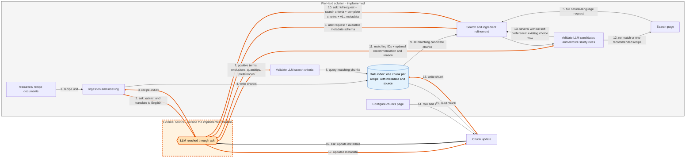
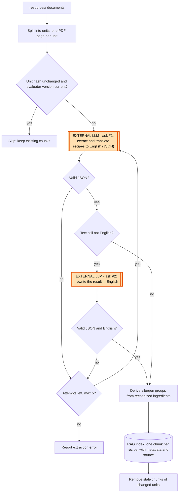
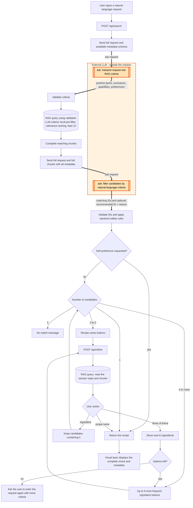
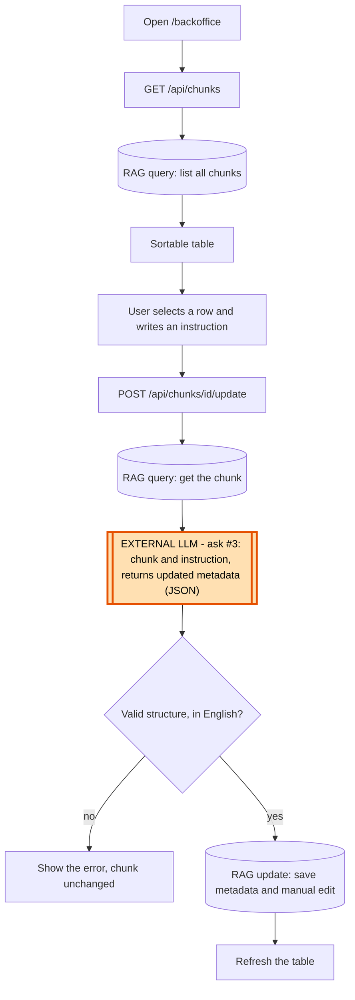

# Process diagram

Mermaid diagrams of the Pie Hard flows. They show where the RAG index is queried and where the LLM (`ask` in `src/llm.py`) is called.

Legend: `[(...)]` RAG index (SQLite) · `[[...]]` LLM call (`ask`) · plain boxes are deterministic backend logic.

## Macro process

The orange box is the external LLM. It is not part of the implemented solution and is reached only through the `ask` function (`src/llm.py`). Every orange arrow crossing the solution boundary is an `ask` call.

Search first sends the full request and available metadata schema to the external LLM through `ask`; it separates positive ingredient terms (including quantity-limited ingredients), exclusions, numeric constraints, and soft preferences. The application retrieves all matching RAG chunks, then sends every retrieved chunk with all metadata and the criteria to `ask` again. The LLM filters hard criteria and, when a soft preference is present, recommends one of the remaining candidates with a grounded reason. The application validates IDs and independently applies safety rules before showing the recommendation or existing refinement choices. Ingestion and backoffice edits also call the external LLM through `ask`.

## 1. Ingestion and indexing (LLM)

## 2. Recipe search (RAG retrieval and LLM filtering)

First, the application calls the external LLM through `ask` with the full original request and available chunk schema. It returns positive ingredient terms, exclusions, quantity constraints, and soft preferences separately. For "chocolate with less than 100 g flour, without milk, appealing to children", positive terms are chocolate and flour; milk is excluded, the flour limit is strict, and child-friendliness is a preference. The application queries the RAG with no fixed result limit. Next, it sends the full request, criteria, each complete retrieved chunk, and all metadata to `ask` again. The LLM applies hard filters (exactly 100 g flour does not satisfy "less than 100 g") and recommends one eligible recipe based on the soft preference. Without a soft preference, existing deterministic ingredient and recipe-name refinement remains available.

## 3. Backoffice: Configure chunks (LLM)

## Summary of LLM calls

| # | Where | Purpose | Code |
|---|-------|---------|------|
| 1 | Ingestion | Extract and translate each recipe unit | `src/recipe_index.py` |
| 2 | Ingestion (fallback) | Rewrite untranslated output in English | `src/recipe_index.py` |
| 3 | Recipe search | Convert the full request and metadata schema into RAG retrieval criteria | Search backend via `src/llm.py` |
| 4 | Recipe search | Filter full retrieved chunks and all metadata against the full natural-language request | Search backend via `src/llm.py` |
| 5 | Backoffice | Update chunk metadata from a user instruction | `src/recipe_chunk_editor.py` |

Ingredient refinement after LLM filtering does not call the LLM.
